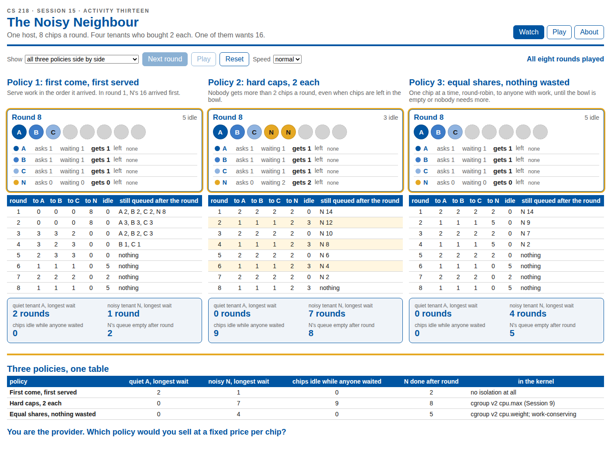

# The Noisy Neighbour

CS 218, Topics in Cloud Computing, San José State University, Fall 2026. Session 15, Activity Thirteen.

One host, 8 chips a round. Four tenants who bought 2 each. One of them wants 16. Three scheduling policies, eight rounds, and only the policy differs.



## Run it

In the browser, at the GitHub Pages URL for this repository (Settings, Pages, Source: GitHub Actions, once). Or on your own machine:

```
git clone <this repository>
cd cs218-noisy-neighbour
npm install
npm run dev
```

`npm run check` re-runs the three policies and compares every round with the course's answer key.

## What it shows

A host has 8 chips a round and one chip serves one unit of work. Four tenants each bought 2 chips a round, a quarter of the host. A, B and C are quiet and ask for 2, 1, 2, 1, 2, 1, 2, 1 over eight rounds. N is noisy and asks for 16 in round 1, then nothing. Every round the demand joins each tenant's queue, the scheduler hands out chips by the policy, and whatever is not served waits.

**Watch** plays the eight rounds under all three policies side by side, or one at a time: the bowl of chips coloured by who got them, each tenant's queue, the round log, and a scoreboard at the end (longest wait for the quiet tenant and the noisy one, chips left idle while someone still had work, the round N's queue empties). The last frame is the debrief table from the lecture and the question it asks.

**Play** makes you the scheduler. Hand out the eight chips by hand each round, then compare your eight rounds with the three policies; the app counts the rounds where you did what each policy would have done.

| Policy | Rule | In the kernel |
|---|---|---|
| First come, first served | Serve work in the order it arrived. In round 1, N's 16 arrived first. | no isolation at all |
| Hard caps, 2 each | Nobody gets more than 2 chips a round, even when chips are left in the bowl. | cgroup v2 `cpu.max` |
| Equal shares, nothing wasted | One chip at a time, round-robin, to anyone with work, until the bowl is empty or nobody needs more. | cgroup v2 `cpu.weight`; work-conserving |

## The numbers

`src/policy.js` is the model and the answer key, ported from the course's `verify.py`. `npm run check` compares every round's allocation, every queue, the longest waits and the idle-while-waiting counts with the tables on the Session 15 slides, and runs in the Pages workflow, so a push that breaks the key does not deploy.

Under first come first served, N's 16 units are placed ahead of A, B and C in round 1. Under equal shares the chips go round-robin in the order A, B, C, N, so when the quiet tenants ask for 1 each in an even round, N gets the other 5.
